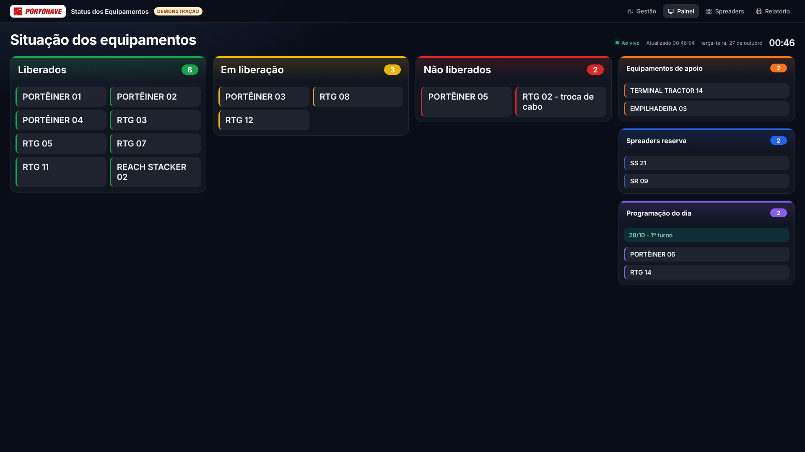
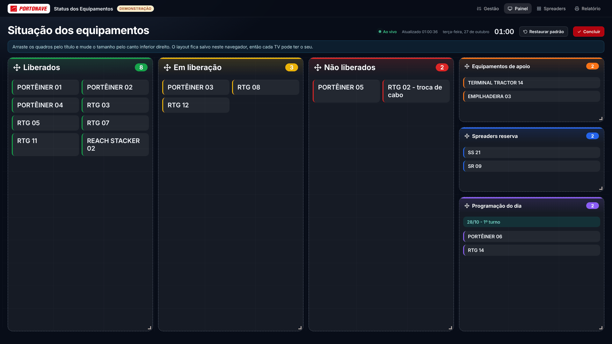
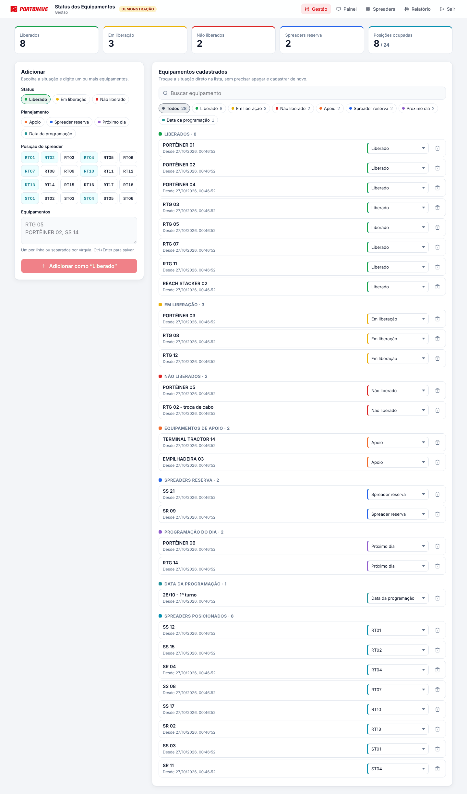
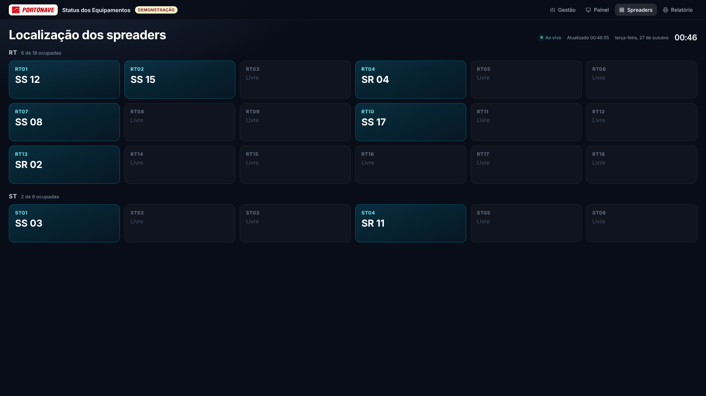
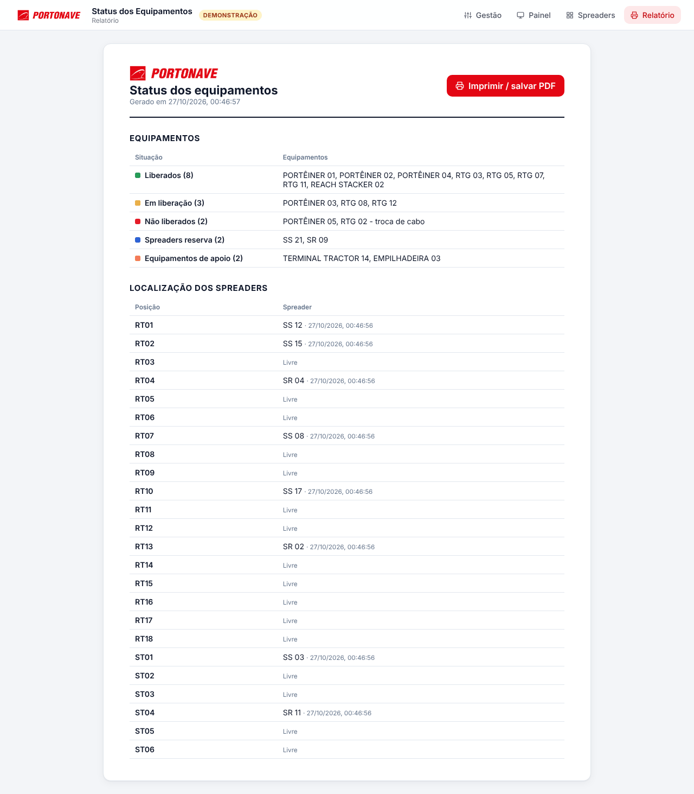

# Status dos Equipamentos · v2

Painel em tempo real da situação dos equipamentos e da localização dos spreaders da Portonave.
Esta é a versão remodelada (branch `redesign`). A versão original continua na branch `master`.



## Páginas

| Rota | O que é |
| --- | --- |
| `/` | **Gestão** (precisa de login): adiciona equipamentos, troca a situação direto na lista, busca e filtra |
| `/PreviewPage` | **Painel** para TV: Liberados, Em liberação, Não liberados, Apoio, Reservas e Programação do dia |
| `/PreviewSpreaderPage` | **Spreaders**: as posições RT01–RT18 e ST01–ST06, ocupadas ou livres |
| `/relatorio` | **Relatório** pronto para imprimir ou salvar em PDF |
| `/login` | Login (Firebase Auth) |

As rotas `/PreviewPage` e `/PreviewSpreaderPage` mantêm o endereço da versão original, para TVs e favoritos continuarem funcionando.

## O que mudou em relação à versão original

- **Trocar a situação sem apagar e recadastrar:** cada equipamento tem um seletor de situação na lista.
- **Vários equipamentos de uma vez:** um por linha ou separados por vírgula.
- **Escolha rápida da situação:** botões de status e grade de posições RT/ST (mostra quais já estão ocupadas), no lugar da lista com 30 opções.
- **Busca, filtros e contadores** na Gestão.
- **Desfazer** ao remover um equipamento.
- **Painéis para TV** com tema escuro, relógio, contadores e indicador "Ao vivo".
- **Painel organizável:** botão "Organizar" para arrastar e redimensionar os quadros. A grade sempre ocupa exatamente a altura da tela, e a letra de cada quadro diminui sozinha quando a lista não cabe. O layout fica salvo no navegador (cada TV guarda o seu) e "Restaurar padrão" volta ao original.
- **Relatório** em uma página só, usando "Imprimir / salvar PDF" do navegador (substitui os dois botões de PDF).
- Funciona no celular.

## Compatibilidade com os dados

Usa o mesmo Firebase e a mesma coleção `Equipamentos`, com os mesmos campos (`name`, `situation`, `created`) e os mesmos valores de situação.
A versão original e esta podem rodar ao mesmo tempo sobre os mesmos dados. A única novidade é o campo opcional `updated`, gravado quando a situação é trocada; a versão original simplesmente o ignora.

## Rodando

```bash
npm install
npm run dev     # usa o Firebase real
npm run demo    # modo demonstração: dados de exemplo em memória, sem login
npm run build
```

O modo demonstração também pode ser aberto em qualquer deploy acrescentando `?demo=1` ao endereço (e `?demo=0` para sair).
Nesse modo nada é gravado no Firebase.

## Telas



| Gestão | Spreaders |
| --- | --- |
|  |  |
| **Relatório** | **Login** |
|  |  |
